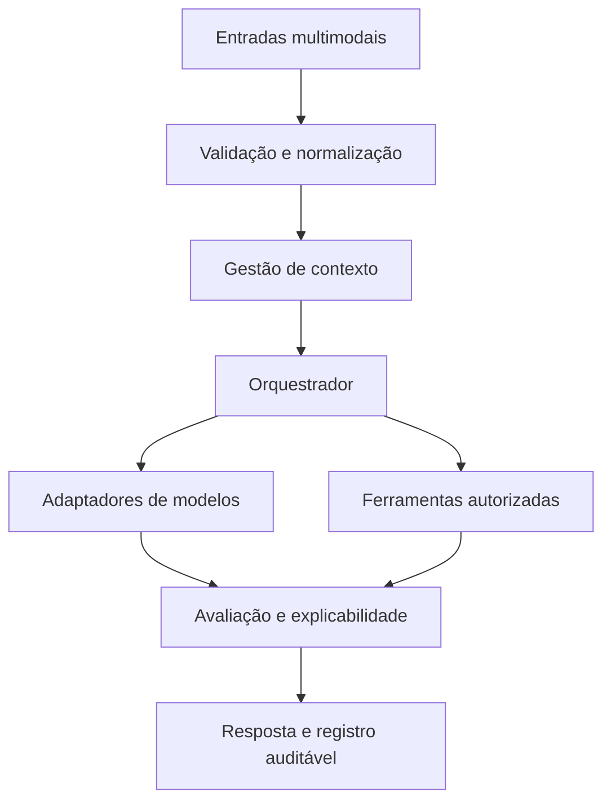

# Canário Soberano X | Projeto experimental de IA multimodal

Repositório inicial para estruturar a pesquisa e o desenvolvimento do Canário Soberano X, conceito de assistente de IA adaptativa com foco em interação multimodal, avaliação de respostas, rastreabilidade e controle do contexto.

> **Maturidade:** repositório inicial de documentação. Não há implementação executável publicada neste commit. As capacidades abaixo são objetivos de pesquisa e desenvolvimento, não recursos operacionais comprovados.

## Objetivos do projeto

- Definir uma base modular para interação por texto e, futuramente, outras modalidades.
- Planejar mecanismos de contexto e memória com controles explícitos.
- Avaliar consistência, segurança, utilidade e incerteza das respostas.
- Documentar decisões de arquitetura e limites de cada experimento.
- Criar testes reproduzíveis antes de ampliar o escopo.

## Arquitetura de referência proposta

Esta representação é conceitual. Integrações com modelos, ferramentas, memória persistente ou dispositivos somente deverão ser declaradas como disponíveis depois de implementadas e testadas.

## Requisitos de qualidade

- Separar dados de entrada, instruções, ferramentas e resultados.
- Validar tipos, tamanho e origem dos dados.
- Aplicar limites de execução e permissões mínimas às ferramentas.
- Evitar armazenar dados sensíveis sem finalidade e consentimento apropriados.
- Registrar versões de modelos, parâmetros e resultados de avaliação.
- Disponibilizar testes unitários e de integração para cada módulo.

## Roteiro de desenvolvimento

- [ ] Especificar casos de uso e critérios de sucesso.
- [ ] Definir arquitetura e contratos internos.
- [ ] Implementar um protótipo textual mínimo.
- [ ] Criar conjunto de testes e avaliações de segurança.
- [ ] Projetar a expansão multimodal por adaptadores independentes.
- [ ] Documentar memória, retenção, privacidade e exclusão de dados.
- [ ] Publicar resultados e limitações de forma reproduzível.

## Como executar

Ainda não existe um comando de instalação ou execução porque o repositório não contém aplicação executável neste commit.

## Contribuição

Propostas devem incluir motivação, escopo, riscos, testes e limitações. Não envie chaves de API, credenciais, dados pessoais ou arquivos confidenciais.

## Licença

Nenhuma licença foi definida neste commit. Não presuma permissão de reutilização até que um arquivo de licença seja adicionado.
