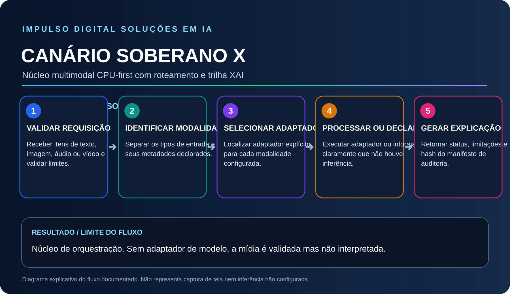

# Canário Soberano X

<p align="center"></p>

**Impulso Digital Soluções em IA** · Python · CPU-first · multimodal · XAI · licença Apache-2.0

Núcleo executável para validação e orquestração de entradas de texto, imagem, áudio e vídeo, com adaptadores explícitos, manifesto de auditoria e explicações sobre o que foi ou não processado.

## Estado desta entrega

O repositório agora contém um núcleo Python testável. O processamento de mídia é feito por adaptadores que precisam ser instalados e configurados pelo integrador. Sem um adaptador, o sistema valida a referência e informa claramente que não realizou inferência. Não há modelo multimodal proprietário embutido, nem download automático de mídia.

## Instalação

```bash
python -m venv .venv
source .venv/bin/activate
python -m pip install -e ".[dev]"
pytest -q
```

## Exemplo

```python
from canario_soberano import CanarioEngine, MultimodalRequest

request = MultimodalRequest.from_dict({
    "request_id": "demo-001",
    "items": [
        {"modality": "text", "content": "Descreva o cenário"},
        {"modality": "image", "uri": "https://example.org/frame.jpg",
         "mime_type": "image/jpeg"}
    ]
})
result = CanarioEngine().process(request)
print(result.to_dict())
```

## Contratos e segurança

- Modalidades aceitas: `text`, `image`, `audio`, `video`.
- Texto tem limite de 20.000 caracteres; até 16 itens por requisição.
- Mídias são referenciadas por URI HTTPS ou arquivo local. O núcleo não baixa URLs.
- Adaptadores implementam `supports(modality)` e `process(item)`.
- O manifesto SHA-256 identifica os metadados normalizados da entrada, não o conteúdo binário.
- Não envie segredos, dados pessoais ou arquivos sensíveis sem controles de acesso, base legal e retenção.

## Limites conhecidos

Este núcleo não contém modelos de visão, fala ou vídeo. A arquitetura permite integrar modelos locais ou serviços externos por adaptadores, mas cada integração precisa de testes, avaliação de qualidade, revisão de segurança e documentação próprias. Não é uma solução certificada nem pronta para decisões de alto impacto.


## Fluxo passo a passo

Consulte o [guia textual com as etapas do projeto](docs/PROCESSO-PASSO-A-PASSO.md). O infográfico acima resume visualmente o mesmo fluxo.
